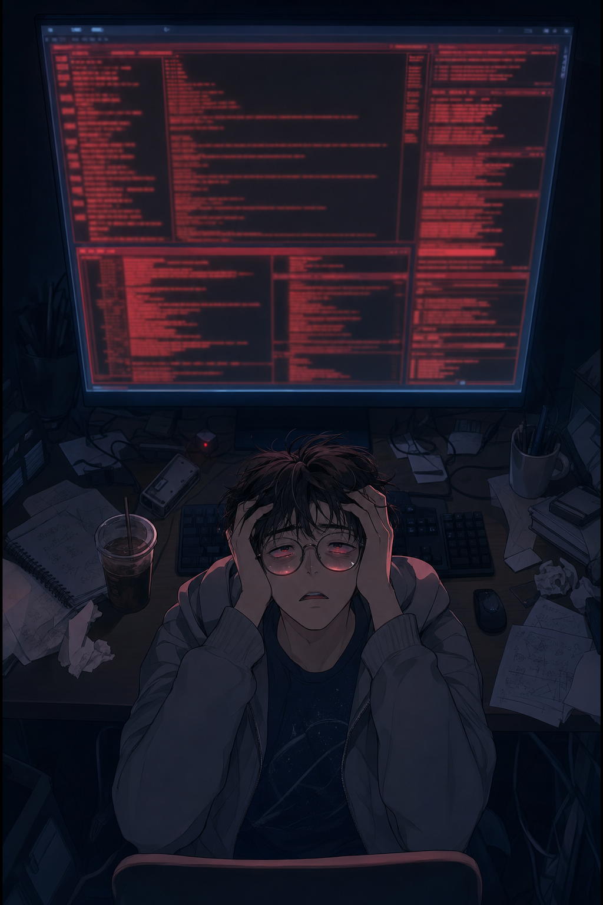
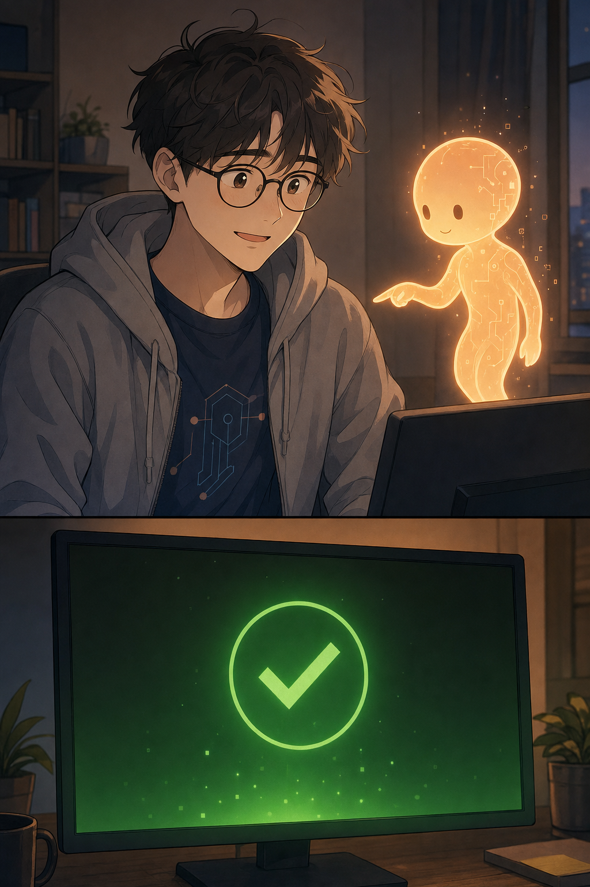

# 클로드와 함께 · 1화 "안 되는 밤"

> 주제: 클로드 코드(AI 코딩 에이전트) · 장르: 개발자 일상 코미디 · 분량: 2컷(세로 스크롤 1024×1536)
> 등장: 개발자(주인공) · 클로드 코드(의인화 AI 조력자)
> 작화: GPT Image(gpt-image-2) · 2컷 생성 완료

---

## cut_001 — 멘붕



- **연출:** 살짝 하이앵글 미디엄샷. 인물은 화면 하단 1/3에 웅크리고, 상단 2/3를 빨간 에러 로그가 압도(짓눌리는 비율). 차가운 암청 `#1C2430` + 빨강 모노 글로우. 컷 아래 **긴 어둠 여백**으로 한 박자 쉼.

| 구분 | 텍스트 | 위치 |
|------|--------|------|
| 내레이션 | 새벽 2시. 같은 에러, 서른일곱 번째. | 상단 띠 |
| 개발자 | "...대체 왜 안 되는 건데." | 얼굴 우측(작게, 힘없이) |
| 효과음 | 삑— | 모니터 우상단 |

<details><summary>GPT Image 프롬프트(cut_001)</summary>

```
Korean webtoon style, clean cel-shaded coloring, thin consistent linework, soft gradient backgrounds, warm cozy lighting, muted warm palette, gentle comedic expression, vertical scroll panel, young man, late 20s, soft round face, tired friendly eyes, messy dark-brown hair, round black glasses, slim build, oversized gray hoodie over navy graphic tee, casual developer look, single character, hunched over a desk with both hands clutching his head, looking up at the monitor, half-closed eyes, mouth slightly open, soul-left-the-body despair, tired sigh, clear dark circles under eyes, red error glow reflected on his glasses, medium shot, slightly high angle looking down, character small in the lower third of the frame, giant monitor filled with red error log blocks dominating the upper two thirds, deep night cramped desk, cold cup of coffee, messy notes and cables, shallow depth with edges fading into darkness, dark cold blue-black room tone #1C2430, only light source is red and blue monitor glow lighting his face from below, lonely oppressive mood, vertical webtoon panel, no text, no speech bubbles, no watermark, no letters, no readable text on screen
```
</details>

<!-- ↓↓↓ 긴 어둠 여백(스크롤 공백) · "한 박자 쉬고" ↓↓↓ -->

---

## cut_002 — 짠, 그리고 통과 ★정점



- **연출:** 아이레벨 투샷(개발자 + 곁에 뜬 클로드 코드) 바스트 + 하단에 초록 PASS 터미널 인서트를 품은 **세로로 긴 큰 컷**. 하이앵글 해제·인물 크게로 심리 회복을 구도로 표현. 코랄/앰버 글로우 `#F6B26B` + 터미널 초록 `#3FB950`이 차가운 암청을 밀어냄(색온도 역전: 차가움→따뜻함). 스크롤로 투샷을 먼저, 초록 PASS를 늦게 터뜨려 반전 완성.

| 구분 | 텍스트 | 위치 |
|------|--------|------|
| 클로드 코드 | "여기요. 세미콜론 하나." | 상단, 가리키는 손끝 근처 |
| 효과음 | 딩! | 모니터 인서트 상단 |
| 개발자 | "...너 언제 왔어." | 얼굴 우측 하단(피식) |
| 클로드 코드 | "계속 옆에 있었는데요." | 클로드 하단 우측(웃으며) |
| 내레이션 | 벽은, 생각보다 얇았다. | 최하단 띠(여운) |

<details><summary>GPT Image 프롬프트(cut_002)</summary>

```
Korean webtoon style, clean cel-shaded coloring, thin consistent linework, soft gradient backgrounds, warm cozy lighting, muted warm palette, gentle comedic expression, vertical scroll panel, young man, late 20s, soft round face, tired friendly eyes, messy dark-brown hair, round black glasses, slim build, oversized gray hoodie over navy graphic tee, casual developer look, small glowing humanoid AI sprite, softly luminous warm-orange body, rounded friendly form, floating, faint digital circuit patterns, gentle amber glow aura, simple dot eyes, translucent edges, no logo, two characters, the young man sits at the desk having released his hands from his head, torso slightly raised, eyes slightly widened with a quiet relieved weak smile, looking between the glowing sprite and the screen, the small glowing sprite floats at his shoulder-to-head height on the right, pointing at a line of code with one small light-tendril hand, calm gentle smile with two dot eyes, two-shot bust framing in the upper part, eye-level angle, both at the same eye level like colleagues, tall vertical composition, lower part is a close-up insert of a terminal monitor that has turned from red to green, with a green PASS checkmark impression and no readable text, same desk but warmth returning, darkness lifting, sprite's warm coral-amber glow #F6B26B softly lighting the space between them, green terminal light #3FB950 rising from below pushing away the cold blue-black, mood shifts from cold to warm, quiet relief, small miracle, vertical webtoon panel, no text, no speech bubbles, no watermark, no letters, exactly two characters
```
</details>

---

## 제작 메모

- 파이프라인: 기획·각본(writer) → 캐릭터·토큰(char) → 콘티(director) → 작화 프롬프트(art-director) → 검수(reviewer)
- 검수 결과: PASS 10 / FIX 3 / REDO 0 (상세: `_workspace/05_review_report.md`)
- 이미지 생성 재개 방법: 유효한 `OPENAI_API_KEY`를 `.env`에 넣은 뒤 아래 실행
  ```
  python .claude/skills/webtoon-art-prompting/scripts/gen_image.py \
    --prompt-file _workspace/04_prompts/cut_001.txt \
    --out output/클로드코드_1화/images/cut_001.png --size 1024x1536
  python .claude/skills/webtoon-art-prompting/scripts/gen_image.py \
    --prompt-file _workspace/04_prompts/cut_002.txt \
    --out output/클로드코드_1화/images/cut_002.png --size 1024x1536
  ```
